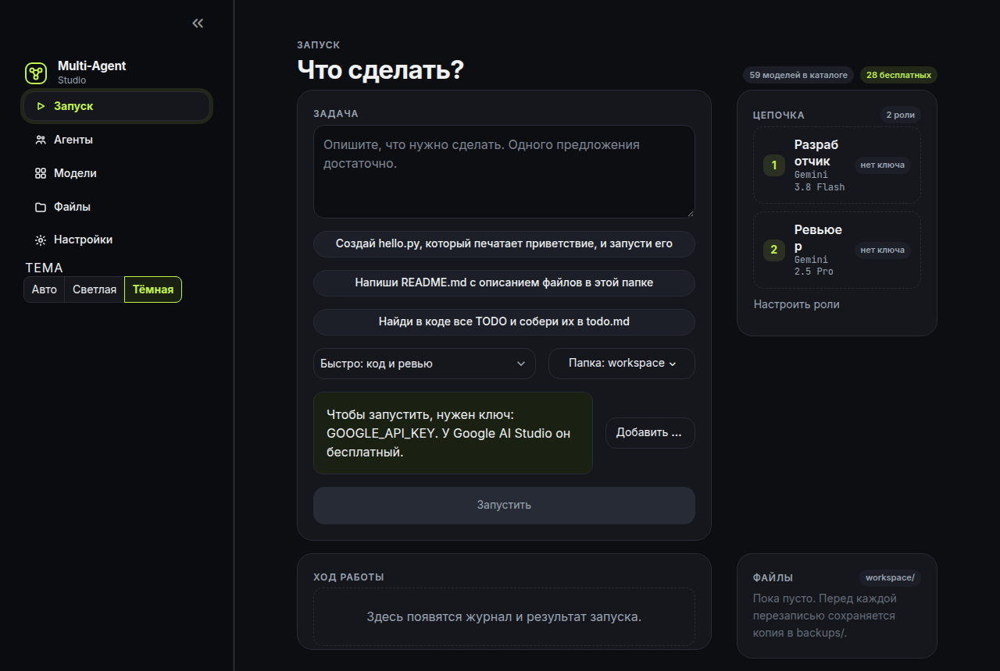

# Улей — многоагентная студия

[](https://github.com/Bot2217/Multi-Agent-Studio/actions/workflows/ci.yml)

Несколько ролей по очереди делают одну задачу, у каждой своя модель. Программа называется «Улей» (Ulei, Hive). Репозиторий на GitHub не переименовывался.



## Скачай установщик

Готовые сборки: [Releases](https://github.com/Bot2217/Multi-Agent-Studio/releases). Браузер не нужен.

- Windows: установщик `.exe` (и `.msi`). SmartScreen может написать «неизвестный издатель» — «Подробнее», затем «Выполнить в любом случае».
- macOS: `.dmg`. Сборка подписана ad-hoc, без аккаунта Apple Developer.
- Linux: `.AppImage` или `.deb`.

### macOS: «приложение повреждено»

Gatekeeper может написать, что «Улей.app» повреждено. Тогда в Терминале:

```bash
xattr -cr "/Applications/Улей.app"
```

или правый клик по приложению → «Открыть».

При запуске «Улей» проверяет обновление. Если оно есть, появится «Доступно обновление» с кнопкой «Установить и перезапустить». Как устроены ключ подписи и первый тег — в [установке](docs/GUIDE.md#desktop).

## Как запустить для разработки

Нужен Python 3. Окно разработки открывается в браузере: [http://localhost:8501](http://localhost:8501).

### Windows

1. Клонируйте репозиторий, не скачивайте ZIP:

   ```bat
   git clone https://github.com/Bot2217/Multi-Agent-Studio.git
   cd Multi-Agent-Studio
   ```

2. Запустите `start.bat`. Он создаст `.venv`, поставит зависимости и откроет студию.

ZIP с GitHub ломает `start.bat`: в архиве у файла концы строк LF. Клонируйте через Git.

### macOS и Linux

```bash
git clone https://github.com/Bot2217/Multi-Agent-Studio.git
cd Multi-Agent-Studio
chmod +x start.sh
./start.sh
```

## Как начать в окне

1. В разделе «Настройки» вставьте ключ и нажмите «Сохранить ключи». Для первого запуска хватит Google.
2. В разделе «Агенты» оставьте роли как есть или выберите модель.
3. В «Запуск» напишите задачу, проверьте режим и папку и нажмите «Запустить».
4. Ход работы и итог появятся ниже; запуск можно остановить. Отчёт можно скачать.

По умолчанию роли стоят на бесплатном тарифе Gemini. Другие бесплатные варианты описаны в [каталоге](docs/GUIDE.md#catalog).

Раздел «Локальные модели» ставит [Ollama](https://ollama.com) без прав администратора в папку данных Улья (`%LOCALAPPDATA%\Улей\ollama` на Windows, рядом — на macOS и Linux). Веса лежат в своей папке, её можно сменить в настройках. Если Ollama уже запущен на порту 11434, Улей пользуется им и не останавливает его при выходе. Установленные модели появляются у агентов как «Ollama (локально)» и ничего не стоят.

## Как обновить

Установленный «Улей» обновляется сам из Releases.

Копия из git:

```bash
git pull
```

На Windows следующий запуск `start.bat` сам делает `git pull --ff-only`. Если обновление не удалось, студия все равно запускается. ZIP с GitHub не обновляется: в нем нет `.git`, нужен `git clone`. На macOS и Linux обновление только по просьбе: `./start.sh --update`.

## Дальше

Подробности в [справочнике](docs/GUIDE.md):

- [Установка и неполадки](docs/GUIDE.md#install)
- [Настольное приложение](docs/GUIDE.md#desktop)
- [Ключи API](docs/GUIDE.md#keys)
- [Каталог моделей](docs/GUIDE.md#catalog)
- [Агенты](docs/GUIDE.md#agents)
- [Файлы](docs/GUIDE.md#files)
- [SSH](docs/GUIDE.md#ssh)
- [Темы](docs/GUIDE.md#themes)
- [Настройки](docs/GUIDE.md#settings)
- [Разработка и CI](docs/GUIDE.md#dev)

## English

Ulei (“Улей”, Hive) is a local multi-agent studio. Download an installer from [Releases](https://github.com/Bot2217/Multi-Agent-Studio/releases). Windows SmartScreen may say the publisher is unknown. On macOS, if Gatekeeper says the app is damaged, run `xattr -cr "/Applications/Улей.app"` or right-click the app and choose Open. For development, clone `https://github.com/Bot2217/Multi-Agent-Studio.git` and run `start.bat` or `./start.sh`, then open [http://localhost:8501](http://localhost:8501). The guide is in Russian: [docs/GUIDE.md](docs/GUIDE.md). The «Локальные модели» screen installs Ollama into the app data folder without administrator rights, stores weights beside it, and offers those models to agents for free. A system Ollama already listening on port 11434 is reused and left running.
