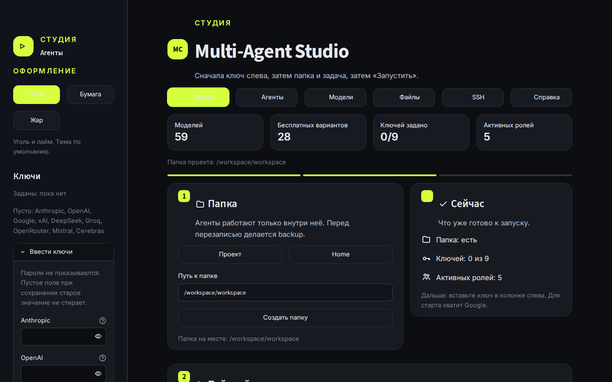

# Multi-Agent Studio

[](https://github.com/Bot2217/Multi-Agent-Studio/actions/workflows/ci.yml)

Локальная студия: несколько ролей по очереди делают одну задачу, у каждой своя модель.



## Как запустить

Нужен Python 3. Открывать студию после запуска: [http://localhost:8501](http://localhost:8501).

### Windows

1. Клонируйте репозиторий, не скачивайте ZIP:

   ```bat
   git clone https://github.com/Bot2217/Multi-Agent-Studio.git
   cd Multi-Agent-Studio
   ```

2. Запустите `start.bat` двойным щелчком или из cmd. Он создаст `.venv`, поставит зависимости и откроет студию.

ZIP с GitHub ломает `start.bat`: в архиве у файла концы строк LF, и cmd режет команды. Клонирование через Git записывает файл правильно. Если архив уже скачан, не запускайте `start.bat`. Поставьте [Git](https://git-scm.com/download/win) и выполните команды выше либо запустите вручную:

```bat
python -m venv .venv
.venv\Scripts\python.exe -m pip install -r requirements.txt
.venv\Scripts\python.exe -m streamlit run app.py
```

### macOS и Linux

```bash
git clone https://github.com/Bot2217/Multi-Agent-Studio.git
cd Multi-Agent-Studio
chmod +x start.sh
./start.sh
```

## Как начать в окне

1. В разделе «Настройки» вставьте ключ и нажмите «Сохранить ключи». Для первого запуска хватит Google.
2. В разделе «Агенты» оставьте роли как есть или выберите модель.
3. В «Запуск» напишите задачу, проверьте режим и папку и нажмите «Запустить».
4. Ход работы и итог появятся ниже; запуск можно остановить. Отчёт можно скачать.

По умолчанию роли стоят на бесплатном тарифе Gemini. Другие бесплатные варианты (OpenRouter, Ollama) описаны в [каталоге](docs/GUIDE.md#catalog).

## Как обновить

В папке проекта:

```bash
git pull
```

На Windows следующий запуск `start.bat` сам делает `git pull --ff-only`. Если обновление не удалось, студия все равно запускается. ZIP с GitHub не обновляется: в нем нет `.git`, нужен `git clone`. На macOS и Linux обновление только по просьбе: `./start.sh --update`.

## Дальше

Подробности в [справочнике](docs/GUIDE.md):

- [Установка и неполадки](docs/GUIDE.md#install)
- [Ключи API](docs/GUIDE.md#keys)
- [Каталог моделей](docs/GUIDE.md#catalog)
- [Агенты](docs/GUIDE.md#agents)
- [Файлы](docs/GUIDE.md#files)
- [SSH](docs/GUIDE.md#ssh)
- [Темы](docs/GUIDE.md#themes)
- [Настройки](docs/GUIDE.md#settings)
- [Разработка и CI](docs/GUIDE.md#dev)

## English

Local multi-agent studio. Each role calls its own model.

Windows: `git clone https://github.com/Bot2217/Multi-Agent-Studio.git`, then `start.bat`. A GitHub ZIP breaks the batch file; clone instead. macOS and Linux: `./start.sh`. Open [http://localhost:8501](http://localhost:8501). The full guide is in Russian: [docs/GUIDE.md](docs/GUIDE.md).
